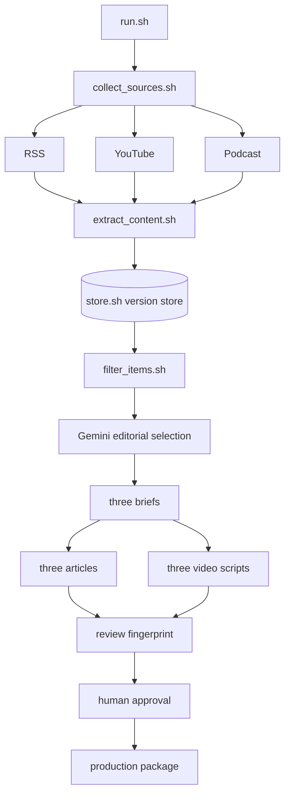

# Problem Set 4 Student Submission

This document is the entry point to the completed Agent Operations Brief pipeline, its retained evidence, editorial records, and published series. The original course instructions remain in [README.md](README.md), and the required contracts remain in [ARCHITECTURE.md](ARCHITECTURE.md).

**Student:** Jiayu Li
**GitHub repository:** [OliviaLJY/ps04](https://github.com/OliviaLJY/ps04)

## Topic and Audience

- **Publication name:** Agent Operations Brief
- **Topic:** Evidence for adopting AI coding agents in small software teams.
- **Audience and assumed knowledge:** Engineering leads at teams of roughly 5–50 people. Readers understand software delivery, code review, testing, and common AI coding tools but do not have time to investigate every launch.
- **Central question:** Which recent AI coding-agent developments justify changing a small team's engineering workflow, and what evidence should leaders demand first?
- **Scope and exclusions:** Includes recent product behavior, independent technical analysis, and practitioner evidence that can change task selection, review design, access controls, measurement, cost, or rollback. Excludes general AI news, unsupported productivity claims, undated sources, and repeated reporting treated as independent corroboration.
- **Reason for readers to return:** Each edition revisits a concrete adoption decision as new operational evidence arrives, separating capability demonstrations from evidence about reliable team outcomes.

## Published Series

| Piece | Title | Substack article | YouTube video |
| --- | --- | --- | --- |
| 1 | The Shift in Engineering Velocity and Platform Controls | [Substack](https://jiayuli2.substack.com/p/the-shift-in-engineering-velocity) | [YouTube](https://youtu.be/KQphqIbbfwc) |
| 2 | Scrutinizing Agent Reliability and Evidence Tensions | [Substack](https://jiayuli2.substack.com/p/scrutinizing-agent-reliability-and) | [YouTube](https://youtu.be/jrnvnG0aBts) |
| 3 | Enterprise Implications and What to Watch Next | [Substack](https://jiayuli2.substack.com/p/enterprise-implications-and-what) | [YouTube](https://youtu.be/pf7xPDqorgI) |

**Separate technical demonstration video:** [YouTube](https://youtu.be/VPIDv-zWuC4)

## Setup and Execution

See [SETUP.md](SETUP.md). The runtime is Bash plus Python 3.9+ and the caption dependency in `requirements.txt`. The no-cost AI path uses `gemini-flash-lite-latest` through `providers/gemini_command.py`; the only credential name is `GEMINI_API_KEY`, stored in ignored `.env.local`. Free-tier inputs may be used by Google to improve its products. `AI_COMMAND` can substitute another JSON-in/JSON-out provider.

Project, source, policy, and prompt inputs live in `config/` and `prompts/`; every run snapshots them. The deterministic fallback is for contract testing and cannot be represented as the required AI-backed editorial run.

After implementation, the required entry commands are:

```bash
bash run.sh
bash run.sh --package runs/20261016T171912Z-50786
```

Useful replay and verification commands are documented in [SETUP.md](SETUP.md). The contract suite runs with `bash tests/contract_test.sh`.

## Architecture and Manual Handoffs



The 16 required Bash entry points remain separate and call focused modules under `pipeline/`. Only `data/store.sh` reaches `data/evidence/`. Source text and immutable timestamp segments are content-addressed under `data/assets/`. The model boundary is `AI_COMMAND`; the included Gemini adapter accepts the snapshotted prompt and evidence and returns the required JSON structure.

Human review starts with `review.json`, `decisions.jsonl`, `briefs.jsonl`, and all six drafts. For the final run, the structural review passed and Jiayu Li approved the matching review fingerprint on 2026-10-16 after checking attribution, factual accuracy, article/video consistency, and policy alignment. `prepare_package.sh` then copied the approved article, script, and source-note files. Production and platform publication were manual handoffs; the verified URLs are retained in `runs/20261016T171912Z-50786/package/publication_links.json`.

## Evidence and Runs

Link to the retained evidence, editorial decisions, briefs, content checks, and intermediate artifacts needed to inspect the complete workflow. Keep referenced text and transcript files accessible. Explain how to retrieve media omitted from the repository.

| Run | Actual date | Run artifacts and logs | Elapsed time | Approximate cost |
| --- | --- | --- | --- | --- |
| Initial failure run | 2026-10-14 | `runs/20261014T142915Z-17727/` | 49.446 s | $0 recorded; deterministic fallback |
| Same-day recovery/replay | 2026-10-14 | `runs/20261014T143320Z-18078/` | 43.404 s | $0 recorded; deterministic fallback |
| Final AI-backed live run | 2026-10-16 | `runs/20261016T171912Z-50786/` | 217.169 s | $0 known/estimated; Gemini free tier |

The first run proved continuation after caption, transcript, and feed failures but lacked all-media editorial coverage. The recovery run added public Transistor transcript parsing and reliable YouTube caption retrieval, producing 64 candidates, 46 extracted items, 36 eligible records, 11 accepts, 7 rejects, 18 deferrals, and six drafts. It recorded 30 unchanged observations and 16 new versions, demonstrating persistent deduplication.

The 2026-10-16 run used `gemini-flash-lite-latest` for selection and generation. It discovered 64 distinct candidates, extracted 45, retained 56 eligible records, and recorded 24 new, 12 changed, and 9 unchanged observations relative to stored evidence. Its summary preserves inaccessible feeds, missing captions, and unavailable podcast transcripts as explicit incomplete coverage instead of silently dropping failures. `tests/contract_test.sh` verifies freshness reasons, duplicate ingestion, changed versions, package approval, and stale-review refusal.

### Published claim trace

Piece 1's statement that GitHub Actions workflow dependency lockfiles entered public preview is marked `claim:01-c1` in `runs/20261016T171912Z-50786/package/articles/01.md`. The claim is defined in `briefs.jsonl` and points to item `feed:1d6b4ba60af7a883ba33`, version `15006d0b17c4ffbab6e9cf94fe639f9149d617da03495d367bd1893831dada76`. In `decisions.jsonl`, the model accepts that item because it supplies direct, fresh evidence of a relevant workflow security control. The immutable evidence index is `data/evidence/index.json`, and the retained source text is `data/assets/848b43dcf01c2b1639cd7cc7/9dffa608a4b5e54d84e038ce8043ed115ee5d746d5daddde1459b22ebef3f4b2.txt`. The brief records the checked quotation: “GitHub Actions workflow dependency lockfiles are now in public preview for GitHub Enterprise Cloud and GitHub Enterprise Cloud with data residency.”

## Editorial Review

The current policy is `config/editorial_policy.md`; revision 1 is preserved at `config/editorial_policy_v1.md`; prompts are under `prompts/`. The final AI-backed decisions are in `runs/20261016T171912Z-50786/decisions.jsonl`, machine review results are in `review.json`, and the signed human approval is in `approval.json`. The approval is bound to review ID `b57ec781c5506841f30c95b0b594858ed7b295a98085193184f50ed307c3e96e`, preventing approval from being reused after draft changes.

Revision 2 adds a publisher-concentration cap and requires review time, failure modes, and total elapsed time before turning capability evidence into adoption advice. Compared with revision 1, it also makes freshness, duplicate identity, commercial incentives, missing perspectives, and claim-level credibility explicit. The practical result is a final series that treats product demonstrations as evidence of possible capability rather than sufficient evidence of reliability or return on investment. The human approval records that no outstanding factual correction was required after the final source, attribution, and cross-format consistency check.

## Reflection

**Insight:** across launch, demonstration, and practitioner material, the recurring decision boundary is operational evidence: a capability demonstration does not answer how review burden, access controls, and recovery affect a small team.

**Limitation:** public caption and transcript availability is uneven, and vendor-heavy sources can dominate a short window. The deterministic development fallback also over-relies on surface textual rules, so the final editorial run used the configured Gemini model and received human review.

**Next improvement:** add a local speech-to-text path for episodes without publisher transcripts and a canonical-claim table that reconciles the same announcement across organizations and formats.

**Architectural tradeoff:** the JSON version store is transparent and easy to inspect, diff, and commit, while SQLite would offer stronger concurrent transactions and queries. A lock-free file store fits a single-student sequential pipeline, and the `store.sh` boundary permits a later SQLite migration without changing other stages.
