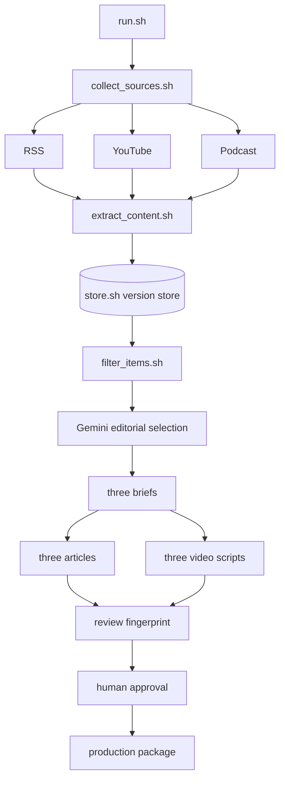

# Problem Set 4 Student Submission

Complete this document with your project details and links. Keep the course instructions in [README.md](README.md) and the required contracts in [ARCHITECTURE.md](ARCHITECTURE.md).

**Student:** Enter your name before submission  
**GitHub repository:** [starter repository](https://github.com/OliviaLJY/ps04) — push this completed working tree to the submitted repository before grading

## Topic and Audience

- **Publication name:** Agent Operations Brief
- **Topic:** Evidence for adopting AI coding agents in small software teams.
- **Audience and assumed knowledge:** Engineering leads at teams of roughly 5–50 people. Readers understand software delivery, code review, testing, and common AI coding tools but do not have time to investigate every launch.
- **Central question:** Which recent AI coding-agent developments justify changing a small team's engineering workflow, and what evidence should leaders demand first?
- **Scope and exclusions:** Includes recent product behavior, independent technical analysis, and practitioner evidence that can change task selection, review design, access controls, measurement, cost, or rollback. Excludes general AI news, unsupported productivity claims, undated sources, and repeated reporting treated as independent corroboration.
- **Reason for readers to return:** Each edition revisits a concrete adoption decision as new operational evidence arrives, separating capability demonstrations from evidence about reliable team outcomes.

## Published Series

Replace each placeholder with the title or working link. Verify that course staff can open every publication.

| Piece | Title | Substack article | YouTube video |
| --- | --- | --- | --- |
| 1 | The signal behind the launches | Pending human review and publication | Pending video production and upload |
| 2 | Claims meet operational evidence | Pending human review and publication | Pending video production and upload |
| 3 | A watchlist for the next decision | Pending human review and publication | Pending video production and upload |

**Separate technical demonstration video:** Pending student recording and upload.

## Setup and Execution

See [SETUP.md](SETUP.md). The runtime is Bash plus Python 3.9+ and the caption dependency in `requirements.txt`. The no-cost AI path uses `gemini-flash-lite-latest` through `providers/gemini_command.py`; the only credential name is `GEMINI_API_KEY`, stored in ignored `.env.local`. Free-tier inputs may be used by Google to improve its products. `AI_COMMAND` can substitute another JSON-in/JSON-out provider.

Project, source, policy, and prompt inputs live in `config/` and `prompts/`; every run snapshots them. The deterministic fallback is for contract testing and cannot be represented as the required AI-backed editorial run.

After implementation, the required entry commands are:

```bash
bash run.sh
bash run.sh --package runs/RUN_ID
```

Replace `RUN_ID` with an actual run directory. Add any setup or stage-replay commands a reviewer needs.

## Architecture and Manual Handoffs



The 16 required Bash entry points remain separate and call focused modules under `pipeline/`. Only `data/store.sh` reaches `data/evidence/`. Source text and immutable timestamp segments are content-addressed under `data/assets/`. The model boundary is `AI_COMMAND`; the included Gemini adapter accepts the snapshotted prompt and evidence and returns the required JSON structure.

Human review starts with `review.json`, `decisions.jsonl`, `briefs.jsonl`, and all six drafts. Complete `docs/human_review_template.md`, correct the drafts, rerun checks, and create matching `approval.json`. `prepare_package.sh` then copies the approved article, script, and source-note files. Render scripts in Google Vids or HeyGen, add on-screen citations and AI disclosure, upload to YouTube, publish the corresponding Substack article, cross-link them, and enter verified URLs in `package/publication_links.json`.

## Evidence and Runs

Link to the retained evidence, editorial decisions, briefs, content checks, and intermediate artifacts needed to inspect the complete workflow. Keep referenced text and transcript files accessible. Explain how to retrieve media omitted from the repository.

| Run | Actual date | Run artifacts and logs | Elapsed time | Approximate cost |
| --- | --- | --- | --- | --- |
| Development/failure run | 2026-10-14 | `runs/20261014T142915Z-17727/` | 49.446 s | $0 recorded; deterministic fallback |
| Complete development run | 2026-10-14 | `runs/20261014T143320Z-18078/` | 43.404 s plus local replay | $0 recorded; deterministic fallback |

The first run proved continuation after caption, transcript, and feed failures but lacked all-media editorial coverage. The completed development run added public Transistor transcript parsing and reliable YouTube caption retrieval, producing 64 candidates, 46 extracted items, 36 eligible records, 11 accepts, 7 rejects, 18 deferrals, and six drafts. It recorded 30 unchanged observations and 16 new versions, demonstrating persistent deduplication. `tests/contract_test.sh` separately verifies all freshness reasons, duplicate ingestion, changed versions, package approval, and stale-review refusal.

These are same-day development runs, not the assignment's required two AI-backed live runs on different days. Run the configured Gemini path on two assignment-week dates and replace this table. Provider costs are unknown to the generic interface; Gemini's configured model is intended for its free tier. Collection failures remain listed in each `summary.json`.

Before publication, choose a final claim marker in `articles/`, find it in `briefs.jsonl`, follow its `item_id` and `version_id` to `decisions.jsonl` and `data/store.sh get`, then verify the exact quote or segment in `data/assets/`. Record that completed trace here after human review; no current draft is represented as published.

## Editorial Review

The current policy is `config/editorial_policy.md`; revision 1 is preserved at `config/editorial_policy_v1.md`; prompts are under `prompts/`. Complete `docs/human_review_template.md` with at least three accepted and three rejected/deferred decisions from an AI-backed run. The existing development decisions came from the clearly labeled deterministic fallback and cannot substitute for this human/model comparison.

Revision 2 adds a publisher-concentration cap and requires review time, failure modes, and total elapsed time before turning capability evidence into adoption advice. Preserve the revision-1 and revision-2 AI decision outputs in separate runs, explain changed choices, and record corrections before creating final approval.

## Reflection

**Provisional insight:** across launch, demonstration, and practitioner material, the recurring decision boundary is operational evidence: a capability demonstration does not answer how review burden, access controls, and recovery affect a small team.

**Limitation:** public caption and transcript availability is uneven, and vendor-heavy sources can dominate a short window. The development fallback also over-relies on surface textual rules; the graded runs must use the configured model and receive human review.

**Next improvement:** add a local speech-to-text path for episodes without publisher transcripts and a canonical-claim table that reconciles the same announcement across organizations and formats.

**Architectural tradeoff:** the JSON version store is transparent and easy to inspect, diff, and commit, while SQLite would offer stronger concurrent transactions and queries. A lock-free file store fits a single-student sequential pipeline, and the `store.sh` boundary permits a later SQLite migration without changing other stages.
